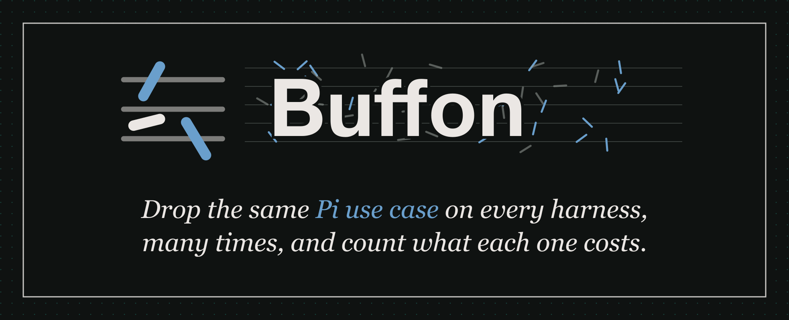

<p align="center">
  
</p>

# Buffon

Benchmarks for coding agents built on Pi's use cases.

Pi is the foundation many coding agents build on. Buffon runs Pi and the agents built on or around it, such as PiG and Pi-Bolt, through the same scripted tasks. Every harness talks to the same scripted model, so a number is the cost of the harness itself: start-up, CPU, memory, sessions, extensions, and how many agents fit on one machine.

The name comes from Buffon's needle, a puzzle the Comte de Buffon published in 1777: drop a needle on a floor of parallel boards, and how often does it cross a line? The answer involves π, so dropping many needles and counting the crossings estimates π. Buffon drops the same Pi use case on every harness, many times, and counts. [More on the name](#why-buffon).

It measures through Pi's lens: Pi's modes, Pi's extensions, Pi's session format. Agents built another way take part where they can, and show "can't run" where they can't. It is not a ranking of agents.

Status: v0 under review, private. No result has been published. Every number a run produces is labelled PROVISIONAL unless its run directory says quiet dedicated hardware.

## Quick start

```sh
git clone <repository-url> buffon && cd buffon     # note: there is no public URL yet; use the one you were given
./buffon.sh up
```

One command detects your machine, installs five harnesses (Pi, PiG, Pi-Bolt, OpenCode 2 and Codex), runs a quick suite against the scripted mock model, and opens the dashboard. It needs Python 3.11 or later, and Node 18 or later to build the dashboard: without Node, `buffon up` stops at once, and `./buffon.sh up --no-dashboard` runs anyway and writes the report and a summary page. It takes a few minutes the first time and is quick the next. On a terminal, bare `./buffon.sh up` opens a picker for the harnesses and benchmarks; `./buffon.sh up --yes` skips the picker and uses the defaults. A harness runs every benchmark it can; one it cannot run shows n/a with the reason. Choose other harnesses and benchmarks with `--harness` and `--bench`, list the choices with `./buffon.sh harnesses` and `./buffon.sh benches`, and see [docs/GETTING-STARTED.md](docs/GETTING-STARTED.md).

## What it measures

- **Cost of the harness itself**: process start, CPU time and memory in print, tool, RPC and terminal modes, rendering a streamed answer, a long session growing and resuming, ten extensions loaded, install and first-run time.
- **Behaviour under faults**: provider errors, dropped streams, kills and signals, judged by rules every harness shares; whether the outcome also matches Pi's is shown beside it.
- **Faithfulness to Pi** (opt-in, `--evals faithfulness`): how closely a harness behaves like the pinned Pi release, probe by probe. No page ranks by it.
- **Other projects' benchmarks**, run unchanged at a pinned commit and kept out of every aggregate.
- **An opt-in field track** (planned): a real model through your own API key under a budget cap you set, kept out of the leaderboard and the grade ([docs/FIELD.md](docs/FIELD.md)).

A family that has no workload yet is listed as not run, and a metric that the code does not produce yet is marked planned. [docs/WHAT-WE-MEASURE.md](docs/WHAT-WE-MEASURE.md) has the state of each.

## Rerun one cell

Every cell in a report has an id of the form `<run id>::<workload>@<api>#<metric>`. One command measures that cell again on your machine and compares your result with the original:

```sh
python3 -m buffon rerun <cell id> --site mine
```

`--print` shows the `buffon run` command without running it. The command uses the arms, rounds, seed and parameters of the original run, and it refuses when this checkout's `arms.lock` differs from the one the run used. See [docs/RUNNING.md](docs/RUNNING.md).

## Limitations

These are the limits of what a number here can tell you. [docs/LIMITATIONS.md](docs/LIMITATIONS.md) has the full list, with what a reader should do about each.

- **A mock model is not a network.** The mock answers at once and without network latency. A real turn is dominated by model and network time, so these numbers describe the part left after you remove them, not the time a person waits.
- **One machine, one kernel.** A number comes from one host. Another CPU, kernel or terminal can give different values, and Buffon states the noise of each run, but it cannot remove the host.
- **Instruction counts depend on the host's counters.** A host with no counters reports CPU time only, and the sample says which instructions were counted.
- **Memory means four different things.** Footprint, RSS, peak RSS and the runtime's own heap differ, and one can sit far below another. A report names which kind each column is. On macOS the footprint also depends on how the runtime's allocator treats `MADV_FREE_REUSE`, and Linux `Private_Dirty` is the like-for-like figure only when every arm's code runs from disk, because code mapped from tmpfs counts as dirty ([why](docs/LIMITATIONS.md#why-a-macos-footprint-depends-on-the-allocator)).
- **Some metrics favour a design.** A harness that deduplicates repeated content gains on a workload that repeats content. The report explains such a metric next to the table.
- **A difference smaller than the noise is not a difference.** Each cell carries the A/A floor of its run, and a gap inside the floor is reported as "no measurable difference".
- **Buffon's authors also build PiG, and PiG is one of the arms.** Every arm runs through the same code, every raw sample ships with the results, and the losses are listed first. Another party can rerun any cell.
- **Faithfulness is graded by probes we wrote.** The probes cover what is listed in [docs/FAITHFULNESS.md](docs/FAITHFULNESS.md) and nothing else.

## Results

No result is published yet, so this page shows no number. A published run's table is generated from its raw samples by `buffon report` and is never edited by hand; `buffon verify` rejects a run whose generated files were changed.

Each arm's section of `report.md` has one row per workload, API and metric, with these columns:

`| workload | api | metric | kind | unit | n | reference median | arm median | ratio [95% CI] | A/A floor | MDE | CV ref / arm | IQR ref / arm | outliers ref / arm | p (Holm) | equivalent (TOST) | note | cell |`

- `kind` is wall time, CPU work, memory or size, and `unit` is the unit of the metric. A row is one kind, so wall time and CPU time are never mixed. `n` is the number of measured repetitions. The medians are in that unit, and the spread of each arm is in the `IQR` and `CV` columns.
- `ratio [95% CI]` is the arm's median over the reference's, paired by round, with a bootstrap interval. A ratio inside the `A/A floor` is reported as "no measurable difference".
- `MDE` is the smallest difference this run could have seen.
- `cell` is the id to give to `buffon rerun`.

[docs/GRADE.md](docs/GRADE.md) defines the one-number grade and its gates: a correctness failure scores the tool-using families as 0, and an entry below the faithfulness floor is ranked in its own table. The report lists the losses of each arm first.

## What each row means

[docs/WHAT-WE-MEASURE.md](docs/WHAT-WE-MEASURE.md) has one section per family. Each gives the metrics, the scenario, why a user might care, and the known limits.

## Documents

| document | contents |
|---|---|
| [docs/WHAT-WE-MEASURE.md](docs/WHAT-WE-MEASURE.md) | every family: what it measures, metrics, why it matters, scenario, limits, state |
| [docs/LIMITATIONS.md](docs/LIMITATIONS.md) | what a number cannot tell you, one section each: the mock, the machine, the four memory kinds and the macOS footprint, design-favouring metrics, and more |
| [docs/METHODOLOGY.md](docs/METHODOLOGY.md) | pinned versions, isolated HOME, mock model, measurement, host and noise, A/A floor, statistics, raw samples, losses, neutrality, prior art |
| [docs/GETTING-STARTED.md](docs/GETTING-STARTED.md) | clone to dashboard: prerequisites per platform, every way to run an evaluation (local, container, Kubernetes, bundle, campaign, rerun, external), report, grade, dashboard, the demo site, publishing |
| [docs/ARCHITECTURE.md](docs/ARCHITECTURE.md) | Mermaid diagrams: component map, one session, samples to a dashboard number, the Kubernetes and campaign flow, each box tied to its module |
| [docs/RUNNING.md](docs/RUNNING.md) | prerequisites, quick start for the local and Kubernetes backends, the site profile reference, what the runner enforces, rerunning one cell |
| [docs/REPORT-TEMPLATE.md](docs/REPORT-TEMPLATE.md) | the layout of a generated report: its sections, a table row, and the memory table with the four kinds and the sample times |
| [docs/GRADE.md](docs/GRADE.md) | the Pi Harness Score: families, weights, gates, how ratios become a number |
| [docs/FAITHFULNESS.md](docs/FAITHFULNESS.md) | the faithfulness score: probe classes, dimensions, weights, limits |
| [docs/FIELD.md](docs/FIELD.md) | the opt-in field track: your own key, a budget cap, a cheap default model, never in the main score (planned) |
| [docs/DESIGN.md](docs/DESIGN.md) | purpose, harness roster, scored axes, reports, architecture, starting code, licences, governance, open decisions |
| [CONTRIBUTING.md](CONTRIBUTING.md) | how a harness author adds or updates a harness, and what happens to its results |
| [docs/RAW-FORMAT.md](docs/RAW-FORMAT.md) | `raw.json` and `facts.json`, the one raw record of a run |
| [docs/TELEMETRY.md](docs/TELEMETRY.md) | per-sample telemetry: what is read, flags, throttling, series and plots |
| [docs/HEALTH.md](docs/HEALTH.md) | the run notes (each check ok or note) and their usual ranges |
| [docs/SUBMITTING.md](docs/SUBMITTING.md) | `buffon verify`, the results index, trust tiers, reproducing a published run |
| [docs/EXTERNAL.md](docs/EXTERNAL.md) | other projects' suites run as they are, published results imported with provenance, kept out of every aggregate |
| [docs/HARNESS-SURVEY.md](docs/HARNESS-SURVEY.md) | sourced survey of 24 candidate harnesses (2026-10-10): versions, licences, install and pinning, endpoints, headless modes, prior benchmarks |
| [docs/design/DASHBOARD.md](docs/design/DASHBOARD.md) | the results site `buffon dashboard` builds: its pages, what each chart shows, the palette and why there are no letter grades |

## Quick start

New here? [docs/GETTING-STARTED.md](docs/GETTING-STARTED.md) has a choose-your-path table, and `python3 tools/pages_site.py /tmp/demo-site` builds a demo dashboard with no run. How it works: [docs/ARCHITECTURE.md](docs/ARCHITECTURE.md). Adding a harness: [CONTRIBUTING.md](CONTRIBUTING.md#how-to-add-it).

```sh
cp sites/example-local.toml sites/mine.toml                     # your cores, your cache directory
python3 -m buffon run overhead --site mine --out runs/first      # install arms, calibrate, measure
python3 -m buffon report runs/first
python3 -m buffon dashboard runs/first --out site                # the results site; open site/index.html (needs Node 18+)
```

For Kubernetes, copy `sites/example-kubernetes.toml` and run the same command; see [docs/RUNNING.md](docs/RUNNING.md). Tests: `python3 -m unittest discover -s tests -t .` (run them this way only; the same command runs in CI on Linux and macOS).

Licence: Apache-2.0 ([LICENSE](LICENSE)). Vendored MIT code keeps its headers: see [NOTICE](NOTICE).

## Why "Buffon"

Buffon's needle is one of the first problems in geometric probability. For a needle no longer than the gap between the lines, the chance that it crosses a line is 2l/(πt), where l is the needle's length and t the gap. So a tally of many drops gives an estimate of π. Buffon asked only for the chance; using it to estimate π came later, and it became the textbook picture of a Monte Carlo method.

Buffon works the same way. Each drop is one round of the same task on every harness. One drop says little; many drops, with the noise measured beside them, say how a harness behaves. And the needle points at Pi, which most of these harnesses build on.
