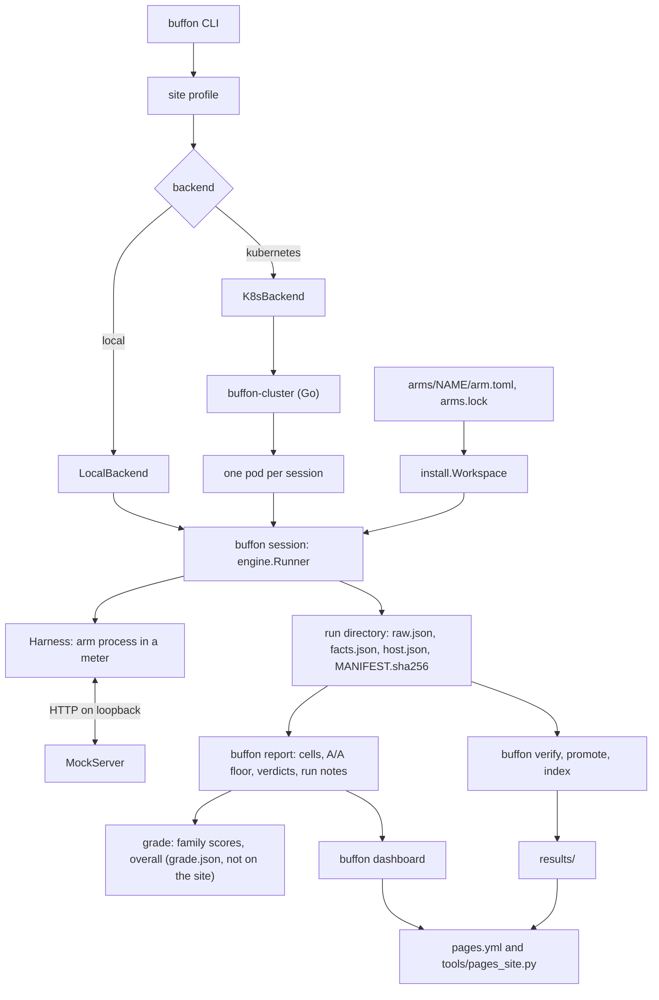
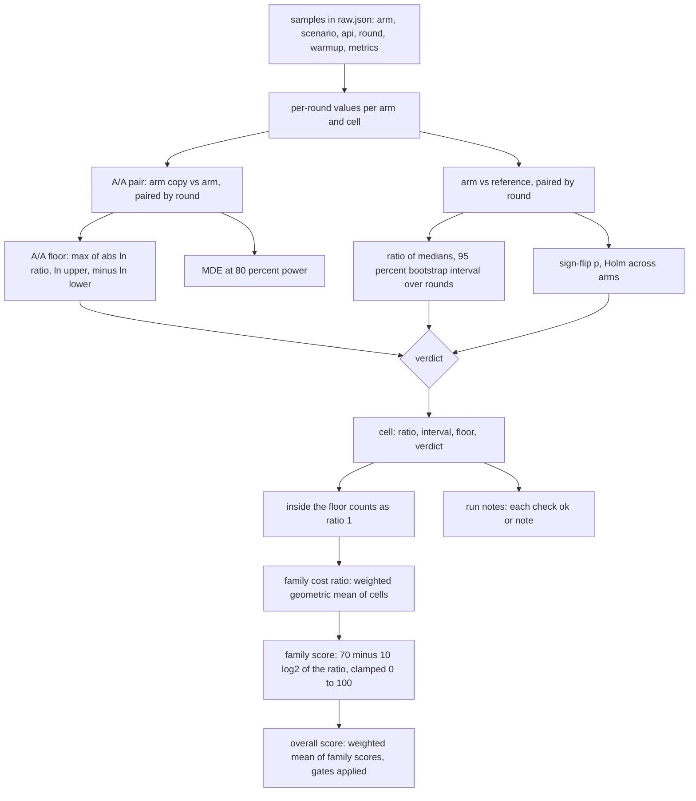
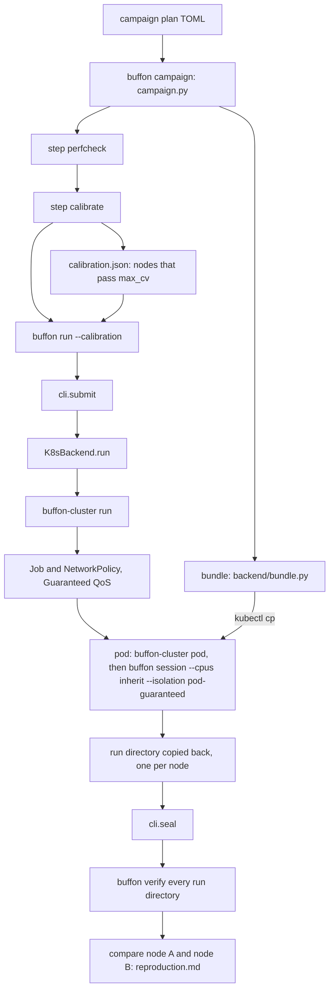

# Architecture

How a run goes from `buffon run` to a number on a page. Every box below is a real module, named in the text under its diagram. Diagrams are Mermaid, which GitHub renders. For commands see [GETTING-STARTED.md](GETTING-STARTED.md). For rules the runner enforces see [RUNNING.md](RUNNING.md) and [METHODOLOGY.md](METHODOLOGY.md).

The idea: every harness (an "arm") talks to one scripted mock model, so a number describes the harness. The runner measures one harness process at a time, interleaves arms round by round, and writes one raw record. Everything after that (report, grade, dashboard) is computed from the raw record and nothing else.

## 1. Component map



| box | code |
|---|---|
| Buffon CLI | `buffon/cli.py` (`build_parser`, `COMMANDS`, `cmd_run`, `submit`). Exit codes: 0 ok, 1 a check rejected its input or a command failed, 2 usage, input or site error, 3 refused before measuring, 4 egress violation |
| site profile | `buffon/site.py` (`load`; TOML at a path or `sites/<name>.toml`; `BUFFON_*` overrides; schema printed by `buffon site schema`) |
| backend | `buffon/backend/__init__.py` (`get_backend`, `Session`, `SessionResult`) |
| LocalBackend | `buffon/backend/local.py`: runs `python3 -m buffon session ...` as a child process on this machine |
| K8sBackend, buffon-cluster | `buffon/backend/k8s.py` calls the Go binary built from `cluster/` (`main.go` commands `render`, `run`, `nodes`, `calibrate`, `check`, `pod`). Bundles: `buffon/backend/bundle.py` |
| Buffon session | `buffon/cli.py:cmd_session` builds an `engine.Plan` (`session_plan`) and calls `buffon/runner/engine.py:run_session` |
| arms, arms.lock | `arms/<id>/arm.toml` (+ `writer.py`, `prepare.py`) validated by `buffon/arms/manifest.py`. `arms.lock` is generated by `buffon/arms/lock.py` |
| install.Workspace | `buffon/arms/install.py`: artifact, `npm ci --ignore-scripts`, source build, derived arm, `prepare` script, A/A copy (`clone`) |
| Harness | `buffon/runner/harness.py` (fresh HOME, scrubbed environment, config written by the arm's writer in `buffon/arms/writers/`). Spawned by `buffon/runner/procio.py` inside a meter from `buffon/runner/cgroup.py` |
| MockServer | `buffon/mock/server.py` (OpenAI Chat Completions, OpenAI Responses, Anthropic Messages), scripted replies from `buffon/mock/transcript.py` and `shapes.py`, per-request log `buffon/mock/reqlog.py` |
| run directory | `buffon/runner/raw.py` (`raw.json`, [RAW-FORMAT.md](RAW-FORMAT.md)), `facts.json`, `host.json`, `mock-requests/`; sealed by `buffon/submit/manifest.py` (`MANIFEST.sha256`) from `cli.seal` |
| report | `buffon/report/render.py` (entry), `cells.py` (cells, comparisons, verdicts), `aa.py`, `noise.py`, `health.py` |
| grade | `buffon/report/grade.py`, `grade_inputs.py`, `grade_render.py`; method fixed in `workloads/grade.toml` ([GRADE.md](GRADE.md)) |
| dashboard | `buffon/dashboard/build.py`, `model.py`, `assets/app.js` ([design/DASHBOARD.md](design/DASHBOARD.md)) |
| verify, promote, index | `buffon/submit/check.py`, `promote.py`, `index.py` ([SUBMITTING.md](SUBMITTING.md)) |
| Pages | `.github/workflows/pages.yml` runs `tools/pages_site.py` |

Two properties hold by construction. The backend only decides where `buffon session` runs; the workload, runner and report code is the same on every backend (`buffon/backend/__init__.py` docstring). And a run directory is the only thing the report reads: `raw.json` is its one input (`buffon/report/render.py`).

## 2. One session

One `buffon run` is one session. A session is one process that installs the arms, calibrates, then measures every sample itself, strictly one harness process at a time.

```mermaid
sequenceDiagram
    participant CLI as buffon run (cli.py)
    participant BE as Backend
    participant S as buffon session (engine.Runner)
    participant W as install.Workspace
    participant M as MockServer
    participant H as Harness in a meter
    participant D as run directory

    CLI->>BE: submit(): session argv from flags and site, b.check()
    BE->>S: python3 -m buffon session ... (child process or pod)
    S->>S: Plan.validate, HostLock, facts, pinning, preflight class, sysinfo
    loop each selected arm
        S->>W: install(arm): sha256 of pins, npm ci or source build, prepare
        W-->>S: executable, version check, arm facts
    end
    S->>W: with_twins: install an A/A copy id-b of each arm
    S->>M: start MockServer, request log in mock-requests/
    opt arms that load the ten extensions
        S->>S: equivalence check, arms must do the same work
    end
    S->>S: calibrate: reference vs its A/A copy, 12 rounds, CV of cpu_ms
    Note over S: CV above 5 percent labels the run Noisy and the run goes on; with --require-class A it refuses with exit 3 (--allow-noisy continues)
    loop warm-up rounds then measured rounds
        loop each workload and API variant, rotated by round
            loop each arm and A/A copy, rotated by round and variant
                S->>S: quiet-host gate: wait for idle pinned CPUs
                S->>H: workload fn: fresh HOME, writer config, spawn argv in a meter
                H->>M: model requests on loopback
                M-->>H: scripted replies
                M-->>S: request times, CPU read at each request
                H-->>S: exit, meter gives CPU, peak memory, RSS, instructions
                S->>S: egress audit, HOME proof, record the sample, failures included
            end
        end
    end
    S->>S: recheck executable and install-tree hashes, idle after, throttling
    S->>D: raw.json, facts.json, host.json
    BE-->>CLI: SessionResult
    CLI->>D: seal: MANIFEST.sha256
    Note over D: later: buffon report, then buffon verify recomputes it
```

Where each step lives:

- **Plan and refusals**: `buffon/runner/engine.py:Plan.validate` (`pinning = "required"` without CPUs; overlapping CPU sets; with `--require-class A`, at least 12 measured rounds unless `--allow-short`). `HostLock` and `QuietGate`: `buffon/runner/quiet.py`. `Runner._run` collects facts (`buffon/runner/facts.py`), runs `buffon/runner/preflight.py` (host class A or B) and `buffon/runner/sysinfo.py`.
- **Install**: `Runner._run` calls `ws.install(arm)` for each arm. The manifest forms are `[artifact.*]`, `[npm]`, `[source]` or `[derive]`; `[prepare] script` finishes an install (`buffon/arms/install.py:Workspace._prepare`). `check_arm_code` refuses an arm whose code runs from tmpfs.
- **A/A copies**: `engine.with_twins` installs a second copy `<id>-b` under its own root and runs it as its own arm in the same rounds. It is the arm's noise reference.
- **Mock**: `MockServer` is started once per session. In container mode it also listens on a unix socket.
- **Equivalence**: `buffon/runner/equivalence.py`, run only when the plan has the ext5 or ext10 workloads (`Runner.gates`).
- **Calibration**: `buffon/runner/calibrate.py:run`. The reference arm (default `pi-node`) and its copy run `overhead/print` for `warmup + 12` rounds, order flipped on odd rounds. The gate is `CV_GATE = 0.05` over `cpu_ms` (`engine.py`).
- **Round-robin**: `Runner.measure`. Warm-up rounds are the first `--warmup` rounds of the same loop, flagged `warmup: true` and dropped later by the report. The order is a deterministic rotation, `rotate(items, k)`, not a random shuffle: variants rotate by round, arms by round plus variant index. This spreads drift across arms. `--seed` (default 20261011) is recorded in `raw.json` (`run.seed`); no code in `buffon/runner/` uses it to shuffle the order, and the report's bootstrap uses its own default seed of the same value (`buffon/report/render.py:render`), not the recorded one.
- **One sample**: `Runner.one_sample` waits for the quiet gate, calls the workload function (`buffon/workloads/overhead.py`, `streaming.py`, `longsession.py`, `devloop.py`), then `egress.take()`, `home_proof`, and builds the record. A crash of a workload becomes a recorded failure, never a silent drop. After three failures in a row an arm sits out that variant (`GIVE_UP_AFTER`).
- **Workload function**: for example `overhead.one_print` creates a `Harness`, resets the mock's policy, opens `cgroup.new_meter()`, runs `procio.Batch(...)`, and reads wall, CPU, peak memory and RSS (`metrics_of`), plus request timing from the mock (`request_metrics`).
- **Meters**: `buffon/runner/cgroup.py`. `CgroupMeter` (Linux cgroup v2, direct or `systemd-run --user`) or `RusageMeter` (`wait4` rusage plus `/proc` or `ps`; used on macOS and in pods). Instruction counts: `buffon/runner/perfcount.py` (`perf_event_open` on Linux, `proc_pid_rusage` on macOS). Egress audit: `buffon/runner/egress.py` (`/proc` every 25 ms on Linux, `lsof` on macOS). Telemetry: `buffon/telemetry/collector.py`, attached as an observer.
- **Seal**: `cli.seal` writes `MANIFEST.sha256` (`buffon/submit/manifest.py`). `buffon verify` (`buffon/submit/check.py`) later recomputes the report from `raw.json` and compares it with the files next to the run.

## 3. From samples to a number on the dashboard



Each step, in the order the code does it:

1. **Per-round values.** `buffon/report/cells.py:per_round` keeps measured (not warm-up, not failed) numeric samples of one arm in one cell `(scenario, api, metric)`, keyed by `(run, round)`. Only lower-is-better cost metrics are scored (`cells.scored`: times, memory, bytes, CPU, instructions).
2. **A/A floor.** `cells.build` pairs each arm's copy with the arm (`stats.pair_by_round`) and `cells.floor_of` takes the ratio of medians of that pair with its bootstrap interval. The floor, in natural-log units, is `max(|ln ratio|, ln upper, -ln lower)`. It is shown as `exp(floor) - 1`. Fewer than 3 usable rounds gives no floor.
3. **Ratio of medians.** `cells.make_comparison` pairs the arm with the reference by round and calls `buffon/stats/paired.py:paired_ratio_of_medians`: `median(arm) / median(reference)` with a 95% percentile interval from 4000 bootstrap resamples that resample whole rounds. Seeded, so the same input gives the same output.
4. **Test and correction.** `paired.sign_flip_p` (exact up to 16 pairs, else 20000 sign-flip resamples) per comparison. `stats.holm` adjusts across the arms of a cell (`cells.compare`).
5. **Floor against the reference.** The floor for a comparison is the larger of the reference's and the arm's own floor (an arm with no copy uses the reference's).
6. **Verdict.** `cells.classify`: inside the floor is "no measurable difference". Outside it, a "loss" (interval above 1) or "win" (interval below 1) needs the Holm-adjusted p below 0.05; otherwise "inconclusive". With no floor, nothing is called equal. `cells.build` also stores the minimum detectable effect from the reference's A/A pair (`paired.mde_ratio`).
7. **Run notes.** `buffon/report/health.py` measures the calibration CV, the A/A gaps and floors, outliers, host flags, throttling and round count. It marks each one `ok` or `note` against the usual ranges in a published table (`buffon health thresholds`, [HEALTH.md](HEALTH.md)). A note informs the reader. It does not grade or reject a run.
8. **Cell to family ratio.** `buffon/report/grade.py:cell_ratio` sets a cell whose ratio lies inside its A/A floor to exactly 1. `timed_family` takes the geometric mean of a family's cells weighted by metric kind (`geomean`). The family is the "suite" level: core, ext10, streaming, long-session, devloop, reliability. Where a cell has an instruction twin, only the instruction cell is used ([GRADE.md](GRADE.md)).
9. **Family score.** `score_of_ratio`: `clamp(70 - 10 log2 r, 0, 100)`. The reference scores 70 by construction. A failed measured sample scores the family 0 (the correctness gate).
10. **Overall.** `overall_of`: the weighted mean of the family scores, with no overall score when coverage is under the floor, or when a family is not yet measurable. A 95% interval comes from a bootstrap over rounds with draws shared by every cell (`grade.bootstrap`).
11. **Dashboard.** `buffon/dashboard/model.py` takes the ratios, intervals, floors and verdicts from the report. With Pi as the baseline the pages show the report's own numbers. With another baseline the page recomputes the ratio of medians over the rounds both harnesses ran, with a paired bootstrap (same method, fixed seed; [design/DASHBOARD.md](design/DASHBOARD.md)). The site shows no overall score, index or grade: steps 8 to 10 only feed `grade.json` and its files. The histogram of a cell's bootstrap draws uses the same draws as the report's interval, and `build()` checks that they give the same interval (`model.py` docstring).

Rows that never enter a cell: the External sections and agent benchmarks (`buffon/external/`, `buffon/agentbench/`). The faithfulness score is never a weight; it only decides which table an entry is ranked in ([GRADE.md](GRADE.md)).

## 4. Kubernetes and campaigns



- **Plan.** `buffon/campaign.py:load_plan` and `check_plan`: tables `[campaign]`, `[calibrate]` and `[[family]]`; at least 12 rounds; arms must be runnable (not held).
- **Bundle.** On a bundle site, `campaign.build_bundle` builds one bundle for every arm of the plan into `<out>/bundle` (or `--bundle DIR`). It carries the repo at HEAD, pinned artifacts, a prefilled npm cache, `buffon-cluster` for the nodes' architecture and `ARTIFACTS.sha256` (`buffon/backend/bundle.py`).
- **Perfcheck.** Step `perfcheck`: `buffon/perfcheck.py`, one pod per target node on a cluster. Exit 3 only means CPU time is the headline; the campaign continues.
- **Calibrate.** `cli.cmd_calibrate` runs only the reference arm against its A/A copy on every node (`--no-calibrate` inside the session so the in-session gate does not stop it), then `K8sBackend.calibrate` calls `buffon-cluster calibrate -max-cv`. It writes `calibration.json`. `cli.calibrated_nodes` lists the nodes that passed.
- **Run.** `cli.cmd_run` with `--calibration` and `--nodes A,B` checks the calibration (`K8sBackend.check_calibration`, `buffon-cluster check`), then `cli.submit` builds the session argv (`--cpus inherit`, `--isolation pod-guaranteed` by default on a Kubernetes site). `K8sBackend.run` calls `buffon-cluster run`, which renders a Job and a NetworkPolicy that allows no traffic, starts the pod, and copies the run directory back. With several nodes, each gets its own run directory named after the node, plus `spread.json`.
- **Pod.** `buffon-cluster pod` runs the session under `taskset` and writes `cluster-facts.json`. The session checks that the pod holds the envelope guarantees (`buffon/envelope/pod.py`): Guaranteed QoS with exclusive cores, digest-pinned image, read-only root, non-root, no network but the mock. A pod that misses any is stamped "uncontained, not comparable".
- **Families.** `campaign.run_families` runs each `[[family]]` on a pair of nodes from `campaign.NodePool`: the family's node and a reproduction node, one after the other, or with `--parallel` as many at once as there are free pairs. Never two sessions on one node.
- **After each family.** `campaign.verify` (`buffon verify` of each run directory) and `campaign.reproduction` (`buffon compare` of the two node runs). State is in `<out>/campaign.json`; running the same command again resumes and skips steps that finished with exit 0.
- **On a local site** (`sites/example-vps.toml`), the calibrate step and the reproduction node are absent. Families run one after the other, each with its own A/A gate, and `--bundle` runs offline from the bundle's cache.

## 5. What is on disk after each stage

| stage | files | written by |
|---|---|---|
| `buffon run` | `raw.json`, `facts.json`, `host.json`, `mock-requests/*.jsonl.gz`, `MANIFEST.sha256`; on Kubernetes also `cluster-facts.json`, `cluster-outcome.json`, `node.json` | `engine.Runner._run`, `cli.seal`, `K8sBackend.run` |
| `buffon report` | `report.md`, `report.html`, `report.json`, `summary.csv`, `rounds.csv`, `noise.csv`, `telemetry.csv`, `health.json`, `grade.json`, `leaderboard.md`, `report-card.md`, `plots/` | `buffon/report/render.py` |
| `buffon dashboard` | the static site: `index.html` (one page, a view per link), `data/site.js` (every number it draws), the report files under `data/`, each run's files under `runs/`, `assets/` | `buffon/dashboard/build.py` |
| `buffon promote` and `index` | `promotion.json` in the run directory, `results/index.json`, `results/INDEX.md` | `buffon/submit/promote.py`, `index.py` |

## Known gaps in this picture

- The round order is a rotation, not a shuffle. If a randomized order is wanted, `Runner.measure` is the place; today the seed does not affect it.
- The word "suite" in this page means a grade family. The CLI uses "suite" for an external benchmark (`buffon external suites`), which is a different thing and never enters a cell.
